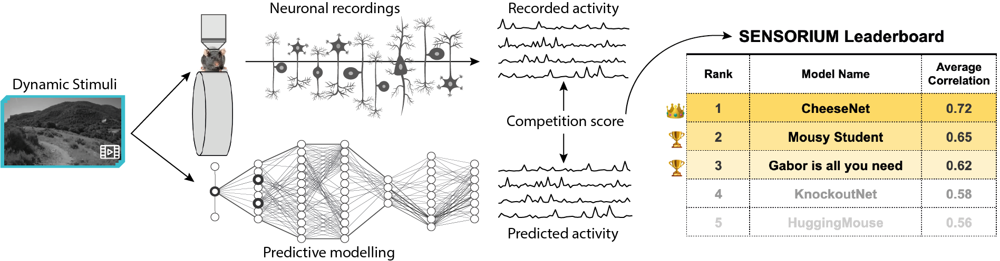

# SENSORIUM 2023 Competition

SENSORIUM is a competition on predicting large scale mouse primary visual cortex activity. We will provide large scale datasets of neuronal activity in the visual cortex of mice. Participants will train models on pairs of natural stimuli and recorded neuronal responses, and submit the predicted responses to a set of test images for which responses are withheld. 

## My Participation Overview
I am thrilled to have participated in the SENSORIUM 2023 Competition! This competition is all about predicting large-scale mouse primary visual cortex activity. Throughout the competition, I worked with extensive datasets of neuronal activity in the visual cortex of mice. My task was to train models using pairs of natural stimuli and recorded neuronal responses, and then submit the predicted responses for a set of test images whose responses were withheld.

For comprehensive details about the competition, I referred to the [SENSORIUM Competition Website](http://sensorium-competition.net/).

## What is in this repository

> **Attribution.** The `sensorium/` package, the two notebooks and the figures are taken from the organizers' official starter kit, [ecker-lab/sensorium_2023](https://github.com/ecker-lab/sensorium_2023) (MIT licence, declared in its `pyproject.toml`). Most files are unchanged; small differences reflect the version I copied. See [NOTICE](NOTICE).

- I entered SENSORIUM 2023 (submission date 6 August 2023) following the starter kit's example pipeline.
- My prediction files and final rank are not included in this repository.
- `notebooks/models_demo.ipynb` in this repo shows a run that stopped with `ModuleNotFoundError: No module named 'sensorium'` (the package was not installed in that environment), so it does not contain trained-model results.

## Acknowledgments
I want to express my gratitude to the competition organizers for creating such an exciting and challenging event. Participating in the SENSORIUM 2023 Competition has been a rewarding experience that has enhanced my skills and knowledge in neural prediction and analysis.

## Contact
If you have any questions or need further information about my participation or submission, feel free to contact me directly. I also appreciate the efforts of the competition organizers, and if you're interested in future editions, be sure to check the [SENSORIUM Competition Website](http://sensorium-competition.net/) for updates.

Thank you for joining me on this journey through the SENSORIUM 2023 Competition!
